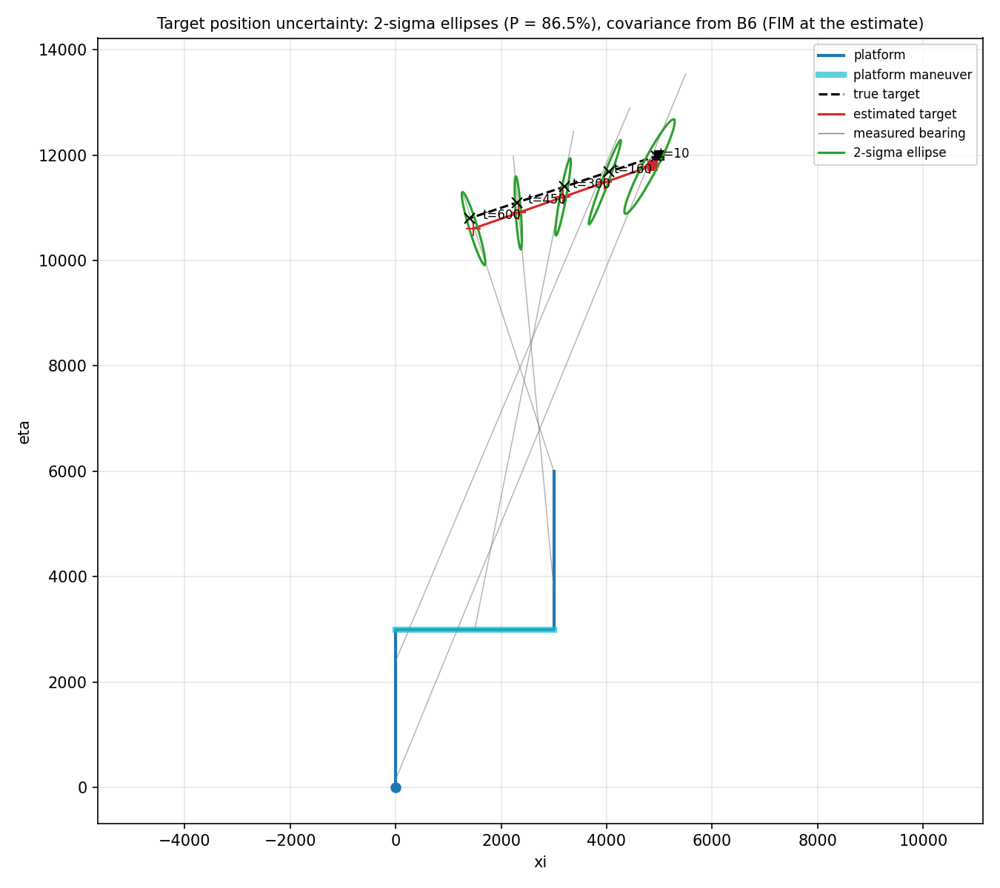

# BEAR / DBEAR — Bearings-Only Target Localization

[](https://github.com/fistfulofyen/Bearings_only_Localization/actions/workflows/tests.yml)

[](LICENSE)

A Python implementation of the project in **Section 3.8.3** of Bar-Shalom, Li &
Kirubarajan, *Estimation with Applications to Tracking and Navigation*, for the
problem of **Section 3.7**. A moving platform measures noisy bearings (angles
only, no range) to a target moving at constant velocity. The programs estimate
the target's initial position and velocity, and test whether the problem is
observable and whether the estimate is statistically consistent.

| Book        | Window (graphical)       | Command line        | What it does |
|-------------|--------------------------|---------------------|--------------|
| `BEAR.EXE`  | `python bear_gui.py`     | `python bear.py`    | Inputs A1–A7 → processing steps B1–B8, report + `bear_results.json` |
| `DBEAR.EXE` | `python dbear_gui.py`    | `python dbear.py`   | g-sigma position uncertainty ellipses at user-chosen times |
| `BEAR.DEF`  | `BEAR.DEF`               | `BEAR.DEF`          | Default inputs (INI format, commented) |



## Documentation

| Document | Content |
|---|---|
| [docs/user_guide.md](docs/user_guide.md) | **User guide for both programs**: a first run, every input, how to read every result, menus, command-line options, file formats, experiments and troubleshooting |
| [docs/algorithms.md](docs/algorithms.md) | The mathematics: model, FIM, observability, MLE, fitting error, NEES, and the g-sigma ellipse algorithm |
| [report/report.tex](report/report.tex) | **Project report (LaTeX)**: problem, solution, theory, experiments, lessons learned, improvements. See [report/README.md](report/README.md) for building it |
| In-program help | Every input and result in the windows has a **?** icon. Hover over it for a short explanation, or click it for details. **F1** opens all help topics. |
| Code | Every module, class and function has a docstring |

## Installation

Requires Python ≥ 3.10.

```bash
pip install -r requirements.txt
```

## Graphical programs

```bash
python bear_gui.py
```

1. **BEAR window, left side:** inputs A1–A7, pre-filled from `BEAR.DEF`.
   - *Load sample* fills in one of five ready-made scenarios.
   - Maneuver legs (A6) are edited in the small table: type values in the row
     below it, then click *Add leg*, *Update selected* or *Remove selected*.
     *Remove all* gives the unobservable case.
   - Noise (A4) can be entered as σ in degrees or as r in rad².
   - *Monte Carlo runs* > 0 adds the average-NEES consistency test.
2. **Run B1–B8** (or press **F5**). The *Summary* tab shows green (pass) or
   red (fail) results for observability, convergence, fitting error, NEES and
   Monte Carlo. Below them are the estimate next to the truth and a plot of
   the geometry. The other tabs hold the full B1–B8 output.
3. **Plot uncertainty ellipses (DBEAR)** opens the DBEAR window on the results
   (BEAR saves them to `bear_results.json` after every run). DBEAR can also be
   started on its own:

   ```bash
   python dbear_gui.py
   ```

   - Enter the times and g, choose the covariance source (B6 or B3), and
     optionally turn on the bearing rays or zoom to the ellipses.
   - The table lists each ellipse's centre, semi-axes, orientation, and
     whether the true position is inside.
   - *Save figure…* exports PNG, PDF or SVG.

Not sure what a field means? Hover over its **?**. The
[user guide](docs/user_guide.md) walks through a complete example.

### Optional: stand-alone Windows programs

The two windows can be packaged as `BEAR.exe` and `DBEAR.exe`, which run on
Windows PCs without Python:

```bash
python -m pip install pyinstaller
```

```bash
python build_exe.py
```

- **Output.** `dist/BEAR.exe`, `dist/DBEAR.exe` (about 70 MB each) and
  `dist/BEAR.DEF`. Keep the three files together.
- **Rebuild after code changes.** The `.exe` files are snapshots; rebuild them
  after changing the code.
- **Start-up** takes about 5 s, with a splash screen.
- **SmartScreen** may warn about an unknown publisher; choose *More info → Run
  anyway*.
- **Self-test.** `BEAR.exe --selftest out.json` and
  `DBEAR.exe --selftest out.json out.png` check a copy on another PC.
- **Distribution.** `build/` and `dist/` are not part of the repository (see
  `.gitignore`). To share the programs, attach the three files from `dist/`
  to a GitHub Release (*Releases → Draft a new release*).

## Command-line programs

### Quick start

```bash
python bear.py
```

Every input is shown with its default from `BEAR.DEF`. Press Enter to keep it
or type a new value. Then plot the results:

```bash
python dbear.py
```

DBEAR asks for the times and the ellipse size g. Non-interactive variants:

```bash
python bear.py --batch --every 10 --mc 500
```

```bash
python dbear.py --batch --times 10 200 400 600 -g 2 --rays --save ellipses.png
```

### `bear.py` options

| Option | Meaning |
|---|---|
| `--def PATH` | defaults file (default: `BEAR.DEF` next to `bear.py`) |
| `-b, --batch` | do not ask; use the defaults file as is |
| `-o PATH` | results file for DBEAR (default `bear_results.json` in the project folder) |
| `--save-def PATH` | save the inputs of this run as a new defaults file |
| `--every M` | print only every M-th row of the per-sample tables |
| `--mc N` | extra: N-run Monte Carlo test of the average NEES |

### `dbear.py` options

| Option | Meaning |
|---|---|
| `results` | results file from BEAR (default `bear_results.json` in the project folder) |
| `--times T ...` | ellipse times (any t ≥ 0, also beyond the last sample) |
| `-g G` | ellipse size in sigmas (default 2 → 86.5 % probability) |
| `--source estimate\|truth` | covariance from B6 (default) or B3 |
| `--rays` | draw the measured lines of sight at those times |
| `--zoom` | zoom the view on the ellipses |
| `--save FILE`, `--no-show`, `-b` | save figure / no window / do not ask |

## Inputs (A1–A7)

| Item | Input | `BEAR.DEF` entry |
|---|---|---|
| A1 | true parameter `x = [ξ0, η0, ξ̇, η̇]` at t = 0 | `[target] x_true` |
| A2 | sampling period T | `[sampling] T` |
| A3 | number of samples n (measurements at t_k = kT, k = 1..n) | `[sampling] n` |
| A4 | noise variance r (rad²); interactively also e.g. `1deg` = σ of 1° | `[noise] r` |
| A5 | platform initial position, velocity | `[platform] position, velocity` |
| A6 | maneuver legs: velocity in effect for k1·T ≤ t < k2·T | `[maneuver 1]`, `[maneuver 2]`, … |
| A7 | initial estimate for the minimization | `[estimation] x_init` |
| — | random seed, method (`gauss-newton`/`bfgs`), confidence level | `[noise] seed`, `[estimation]`, `[statistics]` |

Conventions:
- Units are anything consistent; the defaults use m, s and rad.
- The bearing is measured counter-clockwise from the ξ axis: `atan2(Δη, Δξ)`.
- Outside the maneuver legs, the platform moves with its initial velocity.

## Outputs (B1–B8)

| Step | Output | Code |
|---|---|---|
| B1 | FIM `J = H'H/r` at the true x; observability = invertibility (scale-invariant SVD test) | `model.fisher_information`, `stats.check_observability` |
| B2 | `J⁻¹` (CRLB), standard deviations, correlations | `stats.invert_fim` |
| B3 | position covariance `A(t_k) J⁻¹ A(t_k)'` for every k | `model.position_covariances` |
| B4 | simulated noisy bearings | `Scenario.simulate_measurements` |
| B5 | MLE by Levenberg–Marquardt Gauss–Newton (or BFGS) from A7 | `estimation.maximum_likelihood` |
| B6 | B1–B3 at the estimate | `analysis.analyze_fim` |
| B7 | fitting error `λ(x̂)` vs. the χ²(n−4) interval | `stats.chi2_test` |
| B8 | NEES `x̃'Jx̃` vs. the χ²(4) interval | `stats.nees` |

All formulas, including the documented **g-sigma ellipse algorithm** that the
project asks for, are derived in [docs/algorithms.md](docs/algorithms.md).

## Try this

- **Observability:** delete the `[maneuver 1]` section, or answer `0` to
  "Number of platform maneuver legs". B1 then reports that the FIM is singular
  (rank 3) and the parameter is not observable, because constant-velocity
  motion of both platform and target leaves the range undetermined. DBEAR
  refuses to draw ellipses, since they would be infinite.
- **Consistency:** `python bear.py -b --mc 1000`. The average NEES should be
  close to 4 and inside its interval.
- **Noise level:** enter `0.1deg` or `3deg` for A4 and watch the ellipses
  scale.

## Tests

The tests use only the standard library's `unittest`; pytest also works.

```bash
python -m unittest discover -s tests -t . -v
```

The 152 tests cover:
- **Model:** platform kinematics with maneuvers, bearings, angle wrapping, the
  Jacobian against finite differences, FIM properties, and the analytic null
  vector of the non-maneuvering FIM.
- **Statistics:** the observability test (including scale invariance), the FIM
  inverse, χ² values from published tables, and the NEES distribution.
- **Estimation:** exact recovery from noise-free data, convergence from distant
  starting points, a cost that never increases, bearings crossing ±π, and
  agreement between BFGS and Gauss–Newton.
- **Ellipse:** eigenvalues and orientation against NumPy, every point
  satisfying x'P⁻¹x = g², thin ellipses, and empirical 86.5 % coverage.
- **Statistical consistency and theory** (`test_theory.py`):
  - the FIM equals the covariance of the score;
  - the fitting error is χ²(n−4) in mean and variance (and χ²(n−3) when
    unobservable);
  - NEES is χ²(4) (Kolmogorov–Smirnov test);
  - 2-σ ellipse coverage is 86.5 %;
  - ellipses are elongated along the line of sight;
  - the CRLB scales with σ and with 1/√n;
  - the MLE error covariance matches the CRLB.
- **Range divergence:** data with no finite maximum likelihood are reported as
  diverged by both minimizers, never as "converged".
- **BFGS convergence flag:** a correct BFGS estimate is never reported as
  "not converged" because of SciPy's "precision loss" message.
- **CLI:** `bear.py` and `dbear.py` end to end, including re-prompting on
  invalid input and on overlapping maneuver legs.
- **Samples:** every sample behaves as described.
- **GUI:** both windows driven programmatically while hidden. This covers the
  form round trip, every sample, invalid-field messages, the leg editor, noise
  unit conversion, foreground and background runs, Monte Carlo, the
  unobservable case, DBEAR options, bad files, and figure saving. It also
  covers the `.exe`-only logic: files next to the `.exe`, the bundled
  `BEAR.DEF` fallback, and starting `DBEAR.exe`. These tests are skipped
  automatically if no display is available.
- **Help:** every help topic is complete, every topic has its "?" icon in the
  window, tooltips appear and disappear, clicking opens one re-used Help
  window on the right topic, and F1 works.

## Project layout

```
BEAR.DEF              default inputs
bear.py               BEAR program (interactive CLI)
dbear.py              DBEAR program (ellipse plots, CLI)
bear_gui.py           BEAR window   (-> BEAR.exe)
dbear_gui.py          DBEAR window  (-> DBEAR.exe)
build_exe.py          builds dist/BEAR.exe, dist/DBEAR.exe with PyInstaller
bearloc/
  model.py            kinematics, bearings, Jacobian, FIM, position covariance
  scenario.py         Scenario (A1–A7), BEAR.DEF reader/writer
  estimation.py       MLE: Gauss–Newton/Levenberg–Marquardt and BFGS
  stats.py            observability test, χ² intervals, NEES
  analysis.py         B1–B8 pipeline, Monte Carlo, JSON results
  report.py           text report
  ellipse.py          g-sigma ellipse algorithm
  plotting.py         DBEAR figure and scenario geometry plot
  samples.py          the five sample scenarios
  gui/common.py       file locations (source vs. .exe), input fields, styling
  gui/bear_app.py     BEAR window
  gui/dbear_app.py    DBEAR window
  gui/help.py         "?" icons, tooltips, Help window
  gui/help_text.py    all help texts
docs/user_guide.md    user guide for BEAR and DBEAR
report/               project report (LaTeX), experiment script, figures
docs/algorithms.md    derivations and the ellipse algorithm
tests/                unit and end-to-end tests
```

## License

Released under the [MIT License](LICENSE).
